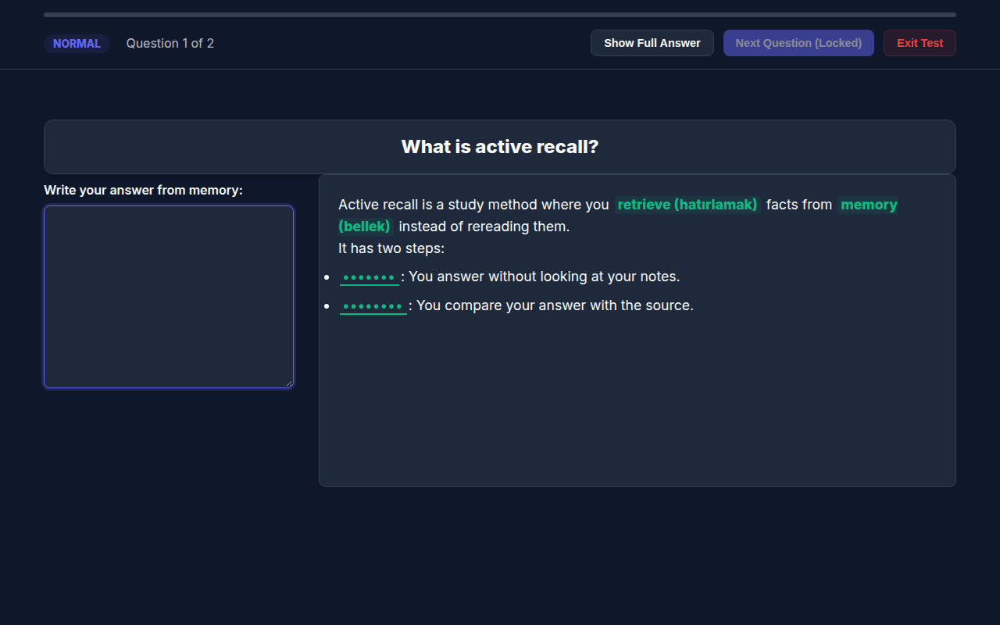

# exam-keywords-game

A browser game for memorizing exam answers: it blanks the key terms in each answer and you recall them by typing.

**Play it:** <https://ivansevill.github.io/exam-keywords-game/>



*Screenshot from a made-up sample deck, not the questions shipped in this repository.*

## Highlights

- **You recall instead of rereading.** A question only unlocks the next one once you have typed every key term, or you give up and show the answer.
- **Small typos don't stop you.** Matching ignores case and accepts 85% similarity, so `memmory` counts as `memory`.
- **Pick how much help you get.** Choose no hints, a letter revealed every 3 seconds, or submit-with-Enter, and browse everything first in the Study Explorer.
- **Your deck is one text file.** Replace `file.csv` to study something else. There is no build step or backend.
- **English and Turkish.** The interface switches between the two, and each keyword can show a translation once found.

## Run it locally

The questions load over HTTP, so opening `index.html` directly fails. Serve the folder instead:

```bash
git clone https://github.com/IvanSevill/exam-keywords-game.git
cd exam-keywords-game
python3 -m http.server 8000
```

Then open <http://localhost:8000>. Any static server works, and the page needs internet access to load PapaParse from cdnjs.

## How to play

Type **one keyword at a time**, not whole sentences: the game compares the entire input box with each keyword.

| Mode | How it works |
|------|--------------|
| Normal | A keyword is detected as you type. No hints. |
| Learning | Same as Normal, and a letter of a random keyword appears every 3 seconds. |
| Fast | Type a keyword and press Enter. |
| Study Explorer | Read all questions, answers, and keywords without playing. |

Questions come in file order. Your score counts the questions finished without **Show Full Answer**, and the last 10 scores stay in your browser's `localStorage`.

## Write your own deck

`file.csv` is pipe-delimited, and the first line must be this header:

```text
question | full_answer | highlights
What is active recall? | Active recall is a study method where you retrieve facts from memory instead of rereading them. $ It has two steps: $ = Attempt: You answer without looking at your notes. $ = Feedback: You compare your answer with the source. | retrieve # memory # Attempt # Feedback @ hatırlamak # bellek # Deneme # Geri bildirim
```

| Marker | Column | Meaning |
|--------|--------|---------|
| `\|` | all | Separates columns, so it can't appear in your text |
| `$` | `full_answer` | Starts a new paragraph or list |
| `=`, `==` | `full_answer` | Bullet, nested bullet |
| `#` | `highlights` | Separates keywords |
| `@` | `highlights` | Comes before the optional translations, matched to keywords by position |

Each keyword should appear in the answer word for word and start and end with a letter or digit. Otherwise it isn't blanked, but you still have to type it to continue. A row with no keywords is skipped.

## Status and limits

This is a small personal study tool with no automated tests. I checked the steps above in Chromium.

- The shipped `file.csv` holds 19 international economics exam questions. To use the game for another subject, replace it.
- In 7 of those 19 questions, some keywords end in punctuation (such as `Terms of Trade:`), so they stay visible in the answer instead of being blanked.
- The in-app help says to type the full answer in Normal mode, but only one keyword at a time is detected.
